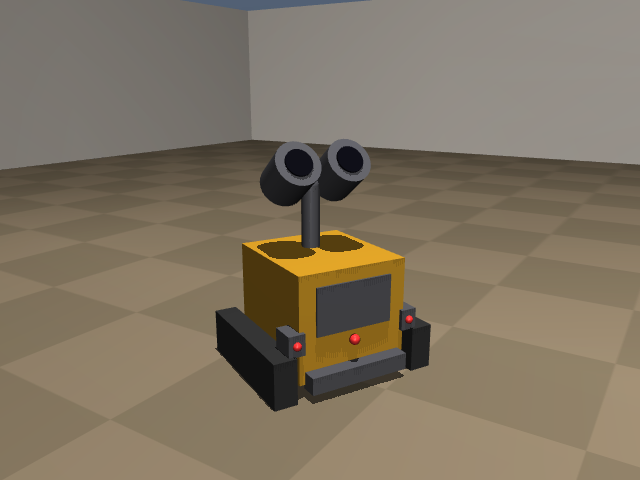
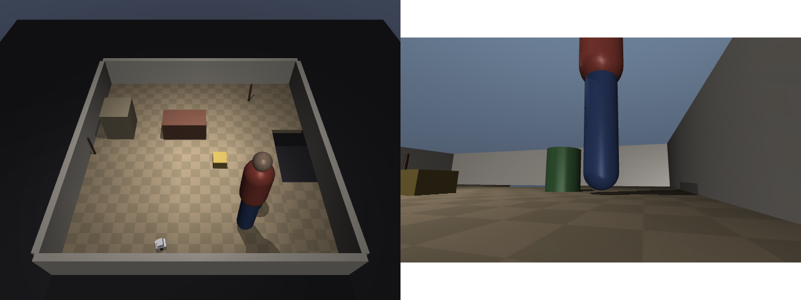

# PetSim: simulate the companion robot before building it

A physics simulation of a small **Wall-E style** companion robot that follows you
around the house. Train and test its behaviour here first, then buy parts and
build the real one once the idea works.

Everything is open source: [MuJoCo](https://mujoco.org) (physics),
[Gymnasium](https://gymnasium.farama.org) (environment API) and
[Stable-Baselines3](https://stable-baselines3.readthedocs.io) (reinforcement learning).





## What's simulated

**The robot** is a Wall-E: a box body (12 × 11 × 10 cm), two tracks, and a
binocular head on a neck. It's about 22 cm tall and 0.8 kg. Each part mirrors the planned real build:

| Simulated | Real part it stands in for |
|---|---|
| Two tracks, each 3 road wheels locked together, middle one driven, torque-limited | Printed TPU tracks, 2 × N20 gear motors with encoders, DRV8833 driver |
| 8 × 8 depth grid in the chest, 45° field of view, 4 m range, ±2% noise | VL53L5CX multi-zone ToF |
| One distance sensor in each "hand", angled 55° outwards | 2 × VL53L1X single-zone ToF |
| 3 downward distance sensors on the front scoop, 2 on the rear | 5 × VL6180X / TCRT5000 cliff sensors |
| Accelerometer + gyro | BMI270 IMU |
| Track speed | Motor encoders |
| Neck with pan (±86°) and tilt | 2 × SG90 / MG90S servos |
| 102° camera in the left eye, photos via `env.take_photo()` | Pi Camera Module 3 Wide |
| Person detector: field of view, occlusion, distance noise, 5% missed frames | MediaPipe/YOLO running on the camera feed |

The **neck works like a reflex**, not something the brain has to learn: whenever
the camera sees you, the head turns towards you and tilts up to your face. The
brain only drives the tracks, and it is told which way the head is pointing.

All dimensions are in `RobotSpec` (`petsim/robot.py`). Change them there to try a
different design, such as bigger wheels, a taller neck or a wider ToF.

**The house** is a 4 × 4 m room with a **stairwell opening** the robot must not
drive into. Furniture is placed at random each episode: a sofa, a cabinet, a plant pot,
thin chair legs and a low box.

**You** are a person who walks between random spots at varying speeds and
sometimes stops. You wait if the robot is in your way.

**Domain randomization** varies the robot's physics each episode: motor strength
(±20%, left and right differ), mass and floor grip (tile vs. rug). This makes a
trained policy robust enough to have a chance on real hardware.

## Safety reflexes

A learned brain is good but never guaranteed, so `petsim/safety.py` sits
between any controller and the motors, like a Roomba's firmware. On the real
robot it runs on the microcontroller, independent of the Pi:

- **Cliff**: if a front cliff sensor loses the floor, back straight off; if a
  rear one does, drive forward.
- **Tilt**: if the body tilts more than ~14° (the tracks are climbing
  something), stop. Tilt comes from a complementary filter fusing the gyro and
  accelerometer, so hard braking doesn't trigger it.

`evaluate.py --no-safety` scores a controller without them.

## The task: follow me

- **Action**: left and right track speeds, in −1 … 1.
- **Observation** (84 numbers, laid out in `OBS` in `petsim/env.py`): the 8×8
  depth grid, 5 cliff readings, 2 side distances, the IMU, track speeds, the
  person detector's output (seen?, direction, distance, seconds since last
  seen), the neck angle and the previous action. All of these come from
  real sensors, so the same policy can run on the robot.
- **Reward**: staying about 1 m from you and facing you. It's penalized for
  bumping into things, getting closer than 0.45 m (a tripping hazard) and
  jerky driving. Falling down the stairs ends the episode with a big penalty.

## Setup (one time)

You need **Python 3.10+** and **Git**.

**1. Download the project**

```bash
git clone -b claude/bold-babbage-0rrozi https://github.com/poojamaurya22/uo.git
cd uo
```

**2. Create and activate an isolated Python environment**

Windows:

```bash
python -m venv .venv
.venv\Scripts\activate
```

Mac / Linux:

```bash
python3 -m venv .venv
source .venv/bin/activate
```

**3. Install the libraries** (a few minutes)

```bash
pip install -r requirements.txt
```

Next time, just `cd uo` and run the activate command from step 2.

## Watch the robot live

Windows / Linux:

```bash
python scripts/watch.py --controller baseline
```

Mac (MuJoCo's viewer needs its own launcher, `mjpython`, installed with it):

```bash
mjpython scripts/watch.py --controller baseline
```

A 3D window opens with the robot following the person. To watch the trained
brain instead, use `--controller runs/ppo/best_model.zip` after training.

| Control | Action |
|---|---|
| Left-drag | Rotate the view |
| Right-drag | Move the view |
| Scroll | Zoom |
| Double-click an object, then Ctrl + right-drag | Push it around |
| Tab | Show / hide side panels |

## Other commands

```bash
python -m pytest -q tests                          # sanity checks (~10 s)
python scripts/evaluate.py --controller baseline   # score the hand-written controller
python scripts/train.py --steps 2000000            # train a brain (~40 min on 4 cores)
python scripts/evaluate.py --controller runs/ppo/best_model.zip --video follow.mp4 --photo photo.png
```

On a server with no screen, set `MUJOCO_GL=egl` (NVIDIA) or
`MUJOCO_GL=osmesa` (CPU) before saving videos or photos.

`evaluate.py` reports the numbers that decide whether the idea works:

```
time at 0.6-1.4 m:      how much of the time it's at a good following distance
person in view:         how often its camera can see you
too close (<0.45 m):    tripping-hazard time
collision steps / min:  bumping into furniture
falls / flips:          stairs
```

## Layout

```
petsim/robot.py      robot + house model (MJCF generated from RobotSpec)
petsim/env.py        Gymnasium environment: sensors, person, reward
petsim/baseline.py   hand-written follow controller (yardstick + safe fallback)
scripts/train.py     PPO training
scripts/evaluate.py  metrics, videos, robot-camera photos
scripts/watch.py     live 3D viewer
tests/               physics and sensor sanity checks
```

## Roadmap

1. **Follow me**: done, and the current task.
2. **Hardware questions to answer in sim**: ~~Is one forward ToF enough?~~ No:
   adding the two side sensors cut the baseline's furniture bumps by about 30%.
   ~~Are front cliff sensors enough?~~ No: the first Wall-E brain backed away
   from the person straight into the stairwell. Rear cliff sensors helped, but
   the brain still occasionally ignored them, which led to the safety reflexes.
   ~~Can the tracks climb furniture?~~ Yes: on a low box they climbed and
   tipped over backwards. The tilt reflex stops them.
   Still open: how much does camera field of view matter? Is the robot fast enough?
3. **More behaviours**: "come here" (go to a voice-call location), return to the
   charging dock, explore and map rooms, react to being picked up (IMU).
4. **Voice and memory**: a speech + Claude layer that turns "take a picture" or
   "follow me" into these behaviours. It runs on a PC, separate from the policy.
5. **Real build**: same observation vector, read from real sensors on a
   Pi Zero 2 W + microcontroller, running the exported policy.

Known simplifications: one room, walls and furniture are simple shapes, and the
person can pass through furniture (but not through the robot).
