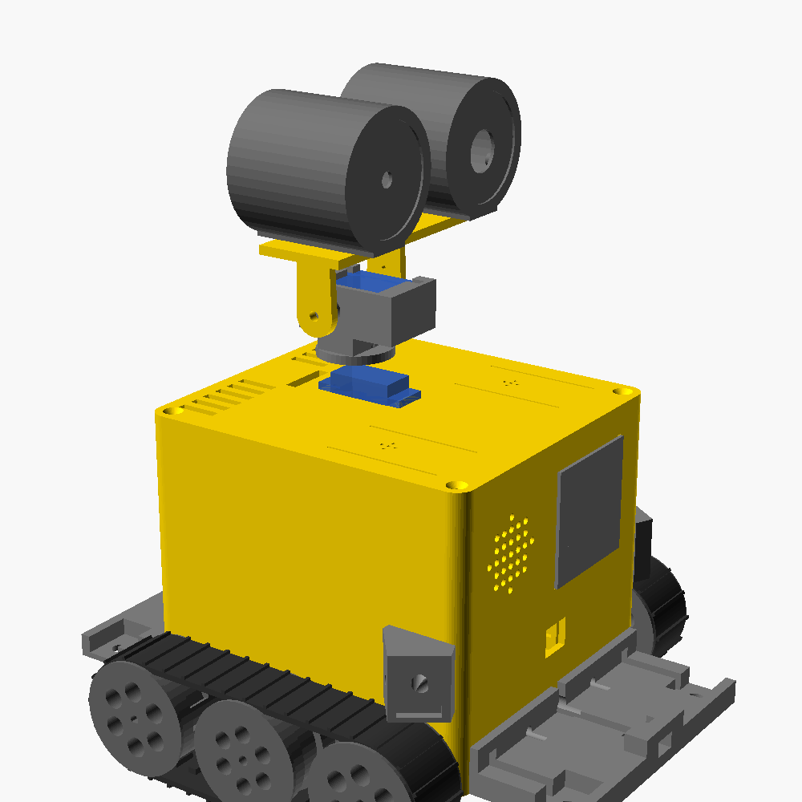
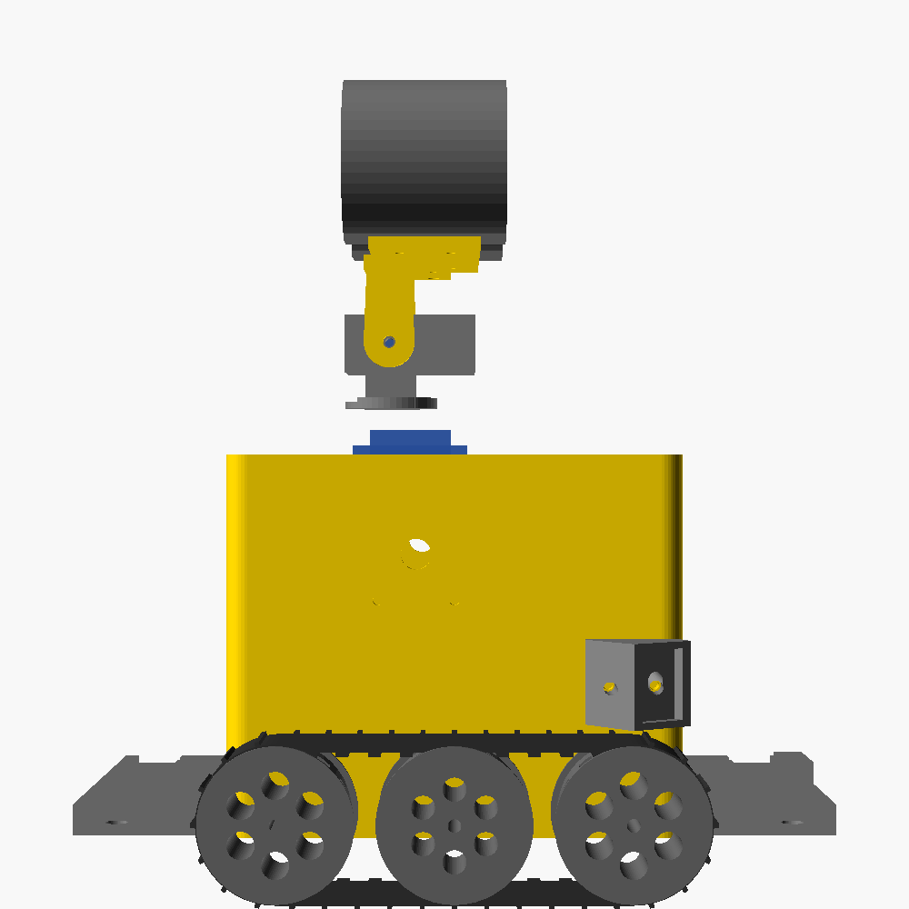

# Building the real Wall-E (v0.1)

Everything here is generated from the same `RobotSpec` the simulation uses, so
the printed robot has the size, track layout, sensor positions and camera
height that the trained brain was tested with.

 

> **Status: first prototype, not yet printed.** The design is complete and
> every part exports cleanly, but nobody has built one yet. Print the
> [fit tests](#1-print-the-fit-tests-first) first, and expect to tweak a few
> sizes. That's normal for a v0.1.

## What you need to buy (India)

About **₹21,000–23,000** for the robot and its charging dock, plus filament and
tools if you don't have them. Prices were checked on Indian stores in October 2026;
they and stock change often, so treat them as a guide.

**Where to order:** most of it from **Robocraze**, motors and servos from **Robu.in**,
the camera from **ElectronicsComp** if Robocraze is out, and screws, wires,
adapter and filament from **Amazon.in**. Buy the Pi and camera only from
authorised resellers: a Pi 5 4 GB under ₹5,000 is probably fake or grey-market.

### Brain and senses

| Qty | Part | What it does | Where | ≈ ₹ |
|---|---|---|---|---|
| 1 | **Raspberry Pi 5, 4 GB** | Main computer: camera, person detection, Wi-Fi, talking to Claude | Robocraze | 6,150 |
| 1 | **Official Pi 5 Active Cooler** | Keeps the Pi 5 from throttling inside the body | Indian Hobby Center, ElectronicsComp | 500 |
| 1 | microSD card, 32 GB (SanDisk / Samsung) | | Amazon.in | 400 |
| 1 | **Raspberry Pi Camera Module 3 Wide** (not NoIR) | The left eye | ElectronicsComp, ElectroPi, Robocraze | 3,700 |
| 1 | **Pi Zero camera cable, 30 cm** (22-pin to 15-pin) | The Pi 5 uses the same narrow connector as the Zero | Robocraze | 92 |
| 1 | **Raspberry Pi Pico** | Real-time microcontroller: motors, sensors, **safety reflexes** | SRK Electronics, ibots | 500 |
| 1 | **VL53L5CX** 8×8 ToF (SmartElex) | Chest depth sensor | Robocraze, The Engineer Store, Robu | 760 |
| 2 | **VL53L1X** ToF (7Semi) | Side sensors in the hands | Robocraze (Flyrobo ₹574) | 839 each |
| 4 | **VL6180X** ToF (SmartElex) | Cliff sensors, one near each corner | Robocraze (Probots ≈ ₹349) | 712 each |
| 1 | **MPU-6050** IMU (GY-521) | Tilt, bumps, being picked up | Probots | 200 |
| 2 | **INMP441** I2S microphone | Ears, under the lid | Robocraze | 136 each |
| 1 | **MAX98357A** I2S amplifier (SmartElex) | Voice | Robocraze, KSP Electronics | 250 |
| 1 | 28 mm 8 Ω speaker | | Robu, Amazon.in | 100 |
| 1 | 5 mm LED + 220 Ω resistor | Right eye status light | anywhere | 10 |
| *(later)* 1 | *1.54" 240×240 IPS screen module (ST7789, SPI)* | *Optional chest screen: battery gauge, expressions, photo previews. The body already has its window* | *Robu, Robocraze* | *≈ 400* |

> Cheaper cliff sensors: 4 × **TCRT5000** IR modules (≈ ₹250 total) work too.

### Movement

| Qty | Part | Notes | Where | ≈ ₹ |
|---|---|---|---|---|
| 2 | **N20 gear motor, 6 V, 200 RPM, with encoder** | Check: 6 V (not 3 V or 12 V), "with encoder", **3 mm D-shaft at least 9 mm long** | Robu (iBots ₹480) | 589 each |
| 1 | **DRV8833** dual motor driver | | Robocraze, ThinkRobotics | 100 |
| 2 | **MG90S** servo, **180°** (not the 360° continuous version) | Neck pan + tilt | Robocraze, Probots, Robu | 229 each |

### Power and charging

| Qty | Part | Notes | Where | ≈ ₹ |
|---|---|---|---|---|
| 4 | **18650 cells, genuine Samsung / LG / Molicel** | 2S2P pack, about 3 h of running. Fakes are common: avoid random sellers and anything claiming > 3,500 mAh | Robu, Robocraze, Hubtronics | 350 each |
| 2 | **2 × 18650 holder** (series, with wires) | Wired in parallel. Charge all 4 cells to the same voltage before connecting them | Robu, Robocraze | 50 each |
| 1 | **2S BMS, 10 A or more** | Protects the cells | Quartz Components (2S 13A), Robu | 100 |
| 1 | **5 V 5 A buck converter** (e.g. XL4015) | Powers the Pi 5, Pico, sensors and servos. Set it to 5.1 V before connecting the Pi | Robu, Robocraze | 250 |
| 1 | **INA219** | Battery level and charging current: tells Wall-E when to go home | Rytronics, DNA Tech | 150–300 |
| 1 | **TP5100 2S charger module** | Charges the pack from 12 V | Hubtronics, Quartz Components | 65 |
| 1 | **12 V 2 A adapter**, 5.5 × 2.1 mm plug | Powers the dock (or plugs straight into Wall-E) | Amazon.in | 300 |
| 2 | **Panel DC jack**, 5.5 × 2.1 mm, 8 mm hole | One on Wall-E's back, one on the dock | Robu, Amazon.in | 30 each |
| 1 | **2-pin magnetic pogo connector pair**, 2.54 mm pitch | The dock contacts: pins on Wall-E's scoop, socket on the dock | Probots | 149 |
| 2 | **1N5822 Schottky diode** | Keeps the contacts and socket from carrying battery power | anywhere | 10 each |
| 1 | Inline fuse holder + 5 A fuse | Cuts power if a wire shorts | anywhere | 40 |
| 1 | **KCD1 mini rocker switch** (19 × 13 mm cutout) | Main power switch on the back | anywhere | 20 |

### Screws and bits

| Qty | Part | Used for |
|---|---|---|
| 4 | M3 × 40 bolt + nyloc nut + 2 washers | Idler and road-wheel axles |
| 14 | M3 × 10 screw (self-tapping into plastic is fine) | Lid (4), hands (4), scoop and lip (4), dock wall (2) |
| 1 | M3 × 8 screw | Head tilt pivot |
| ~16 | M2 × 5 self-tapping screws | Camera (4), motor straps (4), eyes onto the head (4), spares |
| 4 | M2.5 × 6 screws | Pi 5 |
| 2 | M2 × 3 grub screw (optional) | Locks the drive sprockets on the motor shafts |
| 4 | Self-adhesive rubber feet, 12 mm | Under the dock, so it doesn't slide |
| | Hook-up wire, Dupont / JST connectors, heat-shrink, double-sided foam tape, Velcro | |

An assorted M2 / M2.5 / M3 kit (≈ ₹400) plus wires and connectors (≈ ₹300) covers this.

### Filament and tools

| Item | Amount | ≈ ₹ |
|---|---|---|
| PETG (or PLA), yellow | ~250 g | 1,050–1,500 per kg |
| PETG (or PLA), grey | ~300 g (robot + dock) | 1,050–1,500 per kg |
| **TPU 95A**, black (eSUN eTPU-95A) | ~40 g | 2,100–3,400 per kg |
| Soldering iron kit, multimeter (if you don't have them) | | 600 + 500 |

## Printing

All parts are already in print orientation and need **no supports**. Default
settings: 0.2 mm layers, 3 walls, 20% infill.

| File in `stl/` | Qty | Material | Notes |
|---|---|---|---|
| `body.stl` | 1 | PETG/PLA | Biggest part (120 × 110 × 97 mm), ~8 h |
| `lid.stl` | 1 | PETG/PLA | Prints top-down |
| `head.stl` | 1 | PETG/PLA | Plate down |
| `neck.stl` | 1 | PETG/PLA | 4 walls: it carries the head |
| `eye_camera.stl`, `eye_led.stl` | 1 each | PLA | Front face down. Paint or marker the lens recess black |
| `eye_cap.stl` | 2 | PLA | |
| `sprocket_drive.stl` | 2 | PETG | **100% infill** around the hub |
| `sprocket_idler.stl`, `road_wheel.stl` | 2 each | PETG | |
| `spacer.stl` | 4 | any | |
| `motor_strap.stl` | 2 | any | |
| `scoop_front.stl`, `lip_rear.stl` | 1 each | PETG/PLA | |
| `hand_left.stl`, `hand_right.stl` | 1 each | PETG/PLA | |
| `belt.stl` | 2 | **TPU 95A** | Slow (20–30 mm/s), no retraction or very little, 2 walls |
| `chest_cover.stl` | 1 | PETG/PLA | Blanks the screen window until you add a screen |
| `chest_bezel.stl` | (1) | PETG/PLA | Only when you add the screen: frames it instead of the cover |
| `dock_base.stl` | 1 | PETG/PLA | 170 × 210 mm: check it fits your bed |
| `dock_wall.stl` | 1 | PETG/PLA | Marker side up |

`preview/` has a picture of every part.

## Assembly

### 1. Print the fit tests first

Before the big parts, print **one `sprocket_drive`, one `motor_strap` and one
`belt`** (~2 h) and check:

- The sprocket pushes onto the N20 shaft firmly and doesn't wobble.
- The belt fits snugly over two sprockets held ~89 mm apart (axle to axle).
- Your sensor breakouts fit their pockets (the scoop pocket and hand recess are 13.3 × 18.4 mm).
  **Boards sold in India vary in size**: if yours differ, send Claude the board sizes from the listings.

If something is too tight or loose, change `fit` at the top of `walle.scad`
(or a board size under "bought components") and re-export, see
[Changing the design](#changing-the-design). Or ask Claude to do it.

### 2. Drive

1. Push each N20 motor through the square hole at the back of each side wall from
   the inside, until the gearbox sticks out **1 mm**. Screw a `motor_strap`
   across the two blocks on top of it (2 × M2).
2. Push a `sprocket_drive` onto each shaft, hub first (optional M2 grub screw).
3. Front and middle axles: an M3 × 40 bolt from inside the body, through the
   wall, a `spacer`, the `sprocket_idler` (front) or `road_wheel` (middle),
   a washer, then a nyloc nut. Snug, not tight: the wheels must spin freely.
4. Stretch a `belt` over the three wheels, lugs inwards. The front hole is
   slotted: slide the front axle forward to tension the belt, then tighten.

### 3. Sensors

1. **Cliff sensors**: one board in each of the 2 pockets of `scoop_front` and of
   `lip_rear` (the two parts are identical), sensor facing down through the hole. Run the wires along the channels.
   Screw the scoop and lip to the bottom of the front and back walls (2 × M3
   each), wires through the middle hole.
2. **Chest ToF**: slide the VL53L5CX board down the two rails behind the chest window,
   sensor facing out.
3. **Hands**: a VL53L1X in each hand's recess, facing out; screw the hands to
   the sides (2 × M3 each), wires through the hole into the body.
4. **IMU**: tape it flat to the floor, near the middle.

### 4. Electronics inside the body

- **Pi 5** with its Active Cooler on the 4 standoffs on the inside of the back wall,
  fan facing into the body. The vents behind it and in the lid above it let air through.
- **Batteries**: the two holders side by side in the fenced bay on the floor (Velcro).
  Charge all 4 cells to the same voltage first, then wire the holders in parallel.
- **Power switch** and **charging socket** into the two holes low on the back wall.
- **Dock contacts**: glue the spring-pin half of the pogo connector into the slot at
  the front of `scoop_front`, pins facing forward; wires go back along the channel.
- **Pico, DRV8833, buck converter, INA219, TP5100, BMS, amplifier**: double-sided foam tape on the
  floor around the battery bay and on the side walls.
- **Speaker** glued behind the grille; **microphones** taped under the lid's two
  small hole clusters, mic port facing the holes.

How the power is wired, in short:

```
cells (2S2P) -> BMS -> fuse -> switch -> INA219 -> 5 V buck -> Pi 5, Pico, sensors, servos
                                               \-> DRV8833 -> track motors
dock contacts --diode--+
charging socket -diode-+--> TP5100 --> cells (through the BMS)
```

A full wiring diagram comes with the firmware (next step).

### 5. Neck and head

1. Centre both servos before fitting them (power on, send 90°).
2. **Pan servo**: drop it into the lid's rectangular hole with the shaft end towards the back of
   the robot, and screw its tabs down.
3. Screw a round servo horn to the bottom of `neck`, then push it onto the pan servo.
4. **Tilt servo**: drop it into the top of the neck, shaft out to the left side, and screw
   the tabs (2 × M2, from the side).
5. Screw a single-arm horn to the `head`'s arm on the servo side, push it onto
   the tilt servo, and put the M3 × 8 pivot screw through the other arm into
   the neck.
6. **Camera** onto the 4 standoffs inside `eye_camera` (lens through the front
   hole), **LED** into `eye_led`. Screw both eyes onto the head plate (2 × M2
   each from below), then fit the `eye_cap`s.
7. Route the camera cable and tilt servo wires down the back of the neck, through
   the slot in the lid behind the servo. Leave a slack loop inside, because the neck turns ±86°.

### 6. Close up

Lid on, 4 × M3 screws. Done: a Wall-E with no software yet.

### Adding the chest screen later

The square window on the chest is ready for a 1.54" ST7789 screen module. Until then,
`chest_cover` pushes into the recess (a dab of glue or Blu-Tack holds it). To add the
screen: take the lid off, push the cover out from inside, slide the screen down
the two rails behind the window (glass facing out), wire it to the Pi 5's SPI pins
(kept free for this), and press `chest_bezel` into the recess. Before printing the
body, check your module against `screen_board` at the top of `walle.scad`
(36 × 40 mm assumed); if it differs, send Claude its size.

### 7. The charging dock

1. Glue the socket half of the pogo connector into the slot in `dock_base`'s
   contact block, facing Wall-E, and check the polarity against the pins on the scoop
   (the magnets only join one way round).
2. Fit a DC jack in the `dock_wall` and run its wires down the channel to the socket.
3. Screw the wall to the back of the contact block (2 × M3).
4. Print an **ArUco marker** (4×4 dictionary, ID 0, 80 mm square) on paper and glue it
   into the recess on the wall.
5. Rubber feet underneath, put it against a wall, and plug in the 12 V adapter.

Wall-E drives in forwards between the guide arms until the magnets snap the
contacts together. Until the "go home" behaviour is written, you can push it
onto the dock by hand to charge, or plug the adapter straight into its back.

## Changing the design

All sizes come from `RobotSpec` in `petsim/robot.py`, plus a few hardware-only
numbers at the top of `walle.scad`. After changing either:

```bash
python scripts/build_hardware.py --previews
```

This needs [OpenSCAD](https://openscad.org). It regenerates `params.scad` and
every STL. Change the robot in `RobotSpec`, and both the simulation and the
printed parts follow, so you can retrain and re-test before printing.

## Not done yet

- Wiring diagram and the Pico firmware (motors, sensors, safety reflexes)
- Pi software: camera → person detector → trained brain → Pico
- "Go home to charge" behaviour (simulation first, then the robot)
- Voice: microphones → speech-to-text → Claude → speaker
